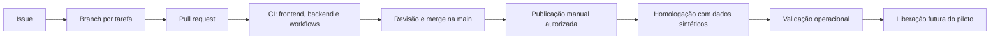

# DevOps da AlumIA

Decisão adotada em 18/11/2026. Objetivo: testar, revisar, publicar e recuperar a plataforma com rastreabilidade e orçamento de infraestrutura zero. Esta etapa prepara a entrega; não libera o piloto para alunos.

## Estado e arquitetura

React e Laravel formam a aplicação do piloto na mesma origem. O Laravel concentra autenticação, sessões, permissões e acesso ao PostgreSQL. O Supabase é o banco gerenciado previsto; sua integração administrativa com o Codex foi verificada, mas a conexão de execução do Laravel, schema e migrações remotas ainda precisam de preparação. Render Free continua candidato à hospedagem, sem contratação ou deploy nesta etapa.

A demonstração usa um build separado e dados fictícios. GitHub Pages serve somente essa demonstração. Não existe ainda pipeline de publicação do piloto, container homologado ou ambiente com alunos.

## Regras adotadas

- Main estável, branches curtas e PRs. Não manter develop permanente nesta fase.
- Cada PR deve explicar comportamento, validação e impacto operacional. Commits atômicos; revisão própria quando não houver outro mantenedor.
- Nenhuma publicação do piloto após merge automático. A pessoa responsável escolhe o commit validado e autoriza a publicação. Agentes podem preparar código, documentação e PRs, mas não acionar deploy ou migração remota sem autorização operacional específica.
- Ambientes separados: desenvolvimento local, homologação sintética e piloto. Antes de haver participantes, o primeiro ambiente remoto pode ser usado para homologação. Ao liberar alunos, ele não poderá continuar recebendo testes sintéticos ou migrações experimentais. Se não houver recursos gratuitos suficientes para a separação, suspender a liberação e decidir a alternativa.
- CI sem dados ou segredos reais, sem credenciais de Supabase e sem acesso ao banco do piloto. O serviço PostgreSQL da CI é descartável.
- Segredos por ambiente, acessos mínimos, ausência de textos e tokens em logs. O frontend não recebe credenciais PostgreSQL nem chaves administrativas.
- Migrações versionadas, preferencialmente aditivas e compatíveis com o código anterior. Backup e plano de recuperação antes de mudanças relevantes. Voltar o código não reverte o banco.
- Mesmo artefato de aplicação promovido entre ambientes, identificado pelo SHA Git; configurações e segredos são fornecidos pelo ambiente. Esse mecanismo será implementado com o container.

## O que os arquivos desta etapa implementam

| Arquivo | Comportamento |
| --- | --- |
| `.github/workflows/backend.yml` | CI completa em push, PR, acionamento manual e chamada reutilizável; sem filtros de caminho |
| CI / Workflow lint | actionlint fixado em versão e SHA256, validando os workflows |
| CI / Frontend tests and builds | instalação pelo lockfile, auditoria completa, incluindo ferramentas (bloqueia high/critical), testes e builds separados de piloto e demonstração |
| CI / Backend SQLite and PostgreSQL | Composer validate/audit, Pint e PHPUnit nos dois bancos; PostgreSQL descartável |
| CI / CI required | só passa quando as três validações anteriores passam; falha ou cancelamento não libera o check |
| `.github/workflows/deploy.yml` | Pages somente manual e na main; chama a CI completa antes de construir e publicar um artefato marcado como demo |
| `.github/dependabot.yml` | PRs semanais para npm, Composer e Actions; versões minor/patch de bibliotecas agrupadas, sem automerge |
| `AGENTS.md`, `CONTRIBUTING.md`, template de PR | regras permanentes para pessoas e agentes, comandos e evidências esperadas |

As Actions externas estão fixadas por SHA completo, com comentário da versão. A CI usa token somente de leitura; apenas o job de publicação recebe escrita de Pages e ID token. Checkout não persiste credenciais. Não executar código de PR com segredos via pull_request_target. Atualizações de versões e dos pins exigem revisão e CI.

A CI termina com a demonstração em `dist`; o piloto sincronizado permanece em `backend/public/app`. O job de publicação constrói seu próprio artefato de demonstração do mesmo commit já validado. A CI não publica nada. Checks locais não comprovam execução dos runners do GitHub.

## Configuração do GitHub a concluir após a primeira CI verde

No ruleset/proteção da main, quando o plano e a visibilidade do repositório permitirem:

1. Exigir PR e o check `CI required` da aplicação GitHub Actions. Conferir o nome mostrado no primeiro PR antes de cadastrar.
2. Exigir resolução das conversas; bloquear force push e exclusão da main.
3. Exigir branch atualizada antes de merge e repetir a CI após mudanças na base.
4. Se houver outro revisor, exigir uma aprovação. Com mantenedor único, não bloquear indefinidamente o merge por exigir aprovação de si mesmo; registrar revisão própria no PR.
5. Restringir o ambiente github-pages à main e revisar quem pode executar Actions. Aprovação adicional por ambiente depende do plano; se indisponível, manter acionamento manual com acesso restrito aos mantenedores.
6. Ativar alertas de dependências e proteção de segredos quando disponíveis. Dependabot version updates só começa após a configuração chegar à branch padrão.

Essas regras de conta não são criadas apenas ao versionar YAML. Sua ativação e sua disponibilidade ainda precisam ser verificadas no GitHub. A política de PR passa a valer imediatamente para o trabalho novo, mas o bloqueio técnico só existe após configurar o repositório.

## Próximas entregas

| ID | Entrega e aceite | Estado |
| --- | --- | --- |
| OPS-001 | Documentação, regras dos agentes, template de PR e CI sem acesso real | Validada na CI remota de push e PR em 18/11/2026 |
| OPS-002 | Ativar proteção da main e revisar permissões depois do primeiro PR verde | Proteção da main ativa e permissões de Actions verificadas em 18/11/2026 |
| OPS-007 | Atualizar Vite/plugin e cadeia de build, corrigir os achados de ferramentas e repetir auditoria completa e os dois builds | Vite/plugin atualizados; auditoria completa sem achados, builds e CI remota aprovados no PR #2 |
| OPS-003 | Container React/Laravel com servidor HTTP apropriado, build reproduzível e health checks; executar localmente e registrar evidências | Pendente; não tratar Dockerfile não testado como pronto |
| OPS-004 | Homologação gratuita com dados sintéticos, segredos por ambiente, artefato por SHA e publicação manual serializada | Pendente da escolha e validação da hospedagem |
| OPS-005 | Backup protegido, restauração em banco separado e recuperação de versão anterior ensaiadas | Pendente; requisito antes de alunos |
| OPS-006 | Homologar acessos e isolamento, falhas de banco e retomada após suspensão; nomear responsável operacional | Pendente; requisito antes de alunos |

Responsável inicial por merge, autorização de publicação e incidentes: mantenedor do repositório. Nomear substituto antes do piloto. Não há operação humana 24 horas presumida.

## Por que não uma skill nova

As regras são parte permanente deste repositório e precisam valer para qualquer agente. AGENTS.md aponta para procedimentos versionados em docs, sem exigir ativação de skill. Só criar uma skill quando houver uma rotina reutilizável com ferramentas ou scripts próprios que agreguem valor sem duplicar essas fontes.

## Referências

- [Segurança de GitHub Actions](https://docs.github.com/en/actions/reference/security/secure-use).
- [Workflows reutilizáveis](https://docs.github.com/en/actions/how-tos/reuse-automations/reuse-workflows).
- [Opções do Dependabot](https://docs.github.com/en/code-security/reference/supply-chain-security/dependabot-options-reference).
- [Arquitetura e limites do piloto](arquitetura-piloto.md).

## Verificação e atualização das dependências

Validação local em 18/11/2026: actionlint 1.7.12 sem erros; 4 testes Node; builds piloto e demo; Composer validate e Pint; 27 testes Laravel em PostgreSQL local com 140 asserções; SQLite com 135 asserções e um teste exclusivo de PostgreSQL pulado. Smoke HTTP local passou com sessões, CSRF e revogação. Nenhum teste usou banco real.

A auditoria inicial completa npm apontou três pacotes com achados: Vite (high), source-map-js (high) e esbuild (moderate), na cadeia de ferramentas. `npm audit --omit=dev` e Composer audit não apontaram vulnerabilidades na consulta. A CI inicial verificava apenas runtime npm e a auditoria completa Composer. A atualização de OPS-007 descrita abaixo corrige essa dívida e amplia o check para as ferramentas. Não usar npm audit fix --force como atalho. Não expor o servidor de desenvolvimento à internet.

Referências dos achados: [Vite](https://github.com/advisories/GHSA-4w7w-66w2-5vf9), [source-map-js](https://github.com/advisories/GHSA-68fv-2mgg-jv7q), [esbuild](https://github.com/advisories/GHSA-67mh-4wv8-2f99).

### OPS-007 — ferramentas do frontend

Atualizados Vite 5.4.21 para 8.3.8 e plugin React 4 para 6.3.0, com versões diretas exatas e lockfile renovado. React 18 e a separação entre piloto/demonstração permanecem. Requisito do projeto: Node 22.12+ na linha 22 (validado localmente com 22.23.5). A configuração simples do projeto não utiliza as opções antigas de esbuild/Rollup substituídas pelo novo bundler.

A auditoria completa npm após a atualização retornou zero vulnerabilidades; os quatro testes do cliente e os dois builds passaram. A CI agora audita todas as dependências npm, incluindo ferramentas, e bloqueia high/critical. O relato acima dos três achados fica como histórico, não como dívida ainda aberta. Nenhuma auditoria garante ausência de vulnerabilidades futuras.

[Guia oficial de migração do Vite](https://vite.dev/guide/migration).

O alvo de sintaxe do build foi fixado explicitamente nos valores padrão anteriores do Vite 5 para evitar mudar esse requisito silenciosamente. Isso não substitui ensaio funcional nos navegadores dos participantes nem adiciona polyfills de APIs do navegador.

Smoke HTTP local do Vite validou HTML, resolução do alias de aplicação e transformação JSX nos modos development e demo após instalação limpa.

### OPS-002 — proteção efetiva no GitHub

Em 18/11/2026, a API confirmou proteção da main com PR obrigatório, check `CI required` vinculado ao GitHub Actions (app 15368), branch atualizada antes do merge, conversas resolvidas, proibição de force push/exclusão e aplicação das regras também a administradores. Não se exige aprovação externa enquanto há mantenedor único; o PR e os checks continuam obrigatórios. As regras acima na seção de configuração descrevem a política e devem ser preservadas.

O token padrão de Actions já estava em leitura, sem permissão para criar/aprovar PRs. O workflow de publicação continua manual e só permite main. Nenhuma execução de publicação foi acionada por esta etapa. A ativação destes workflows na branch padrão ocorre ao incorporar a integração pelo PR final.
